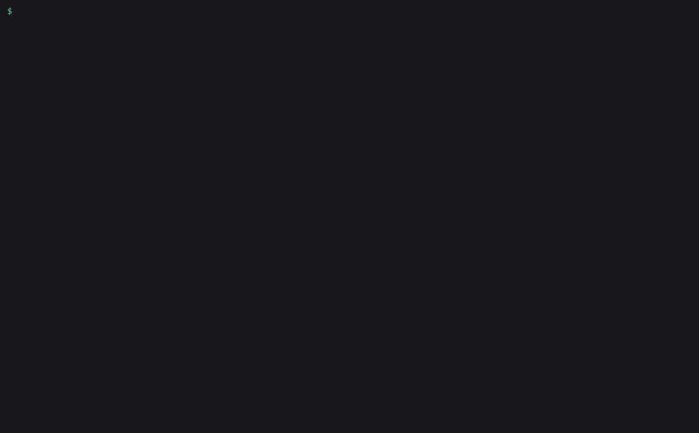

# amagi-benchy-archive

Keep every llama-benchy run from every machine in one folder, with GPU watts
joined in, so you can rank setups, see tokens per joule, and catch the update
that made your model slower.



[llama-benchy](https://github.com/eugr/llama-benchy) measures an
OpenAI-compatible server (llama.cpp, vLLM, SGLang and others) and prints a
table. Run it again next week after a driver update, a new engine build or a
different quant, and the old table is gone or buried in a terminal log.

amagi-benchy-archive keeps them. Each run lands as one JSON file in a plain
folder, tagged with the machine, GPU, engine and quant. If `nvidia-smi` was
sampling while llama-benchy ran, the board power during generation is joined
onto every test. From that folder you get:

- a leaderboard of setups on the same test, sortable by speed or tokens per joule
- a regressions list: the latest run of each setup against the one before it
- one static HTML page with charts, no JavaScript, safe to host anywhere
- markdown, CSV and JSON output for posts and scripts

It reads files and calls `nvidia-smi`, and leaves serving, model loading and
measuring to you and llama-benchy. It uses only the Python standard library
and makes no network calls of its own.

## Install

```
pipx install amagi-benchy-archive
```

Or from source: `pipx install git+https://github.com/amagilabs/amagi-benchy-archive`.

Python 3.9 or newer. You also need llama-benchy 0.4.0 or later on your PATH
(`pipx install llama-benchy`), the first release with `--emit-progress`.

## Usage

### Record a run

`record` starts a power sampler, runs your llama-benchy command, and archives
what it wrote. Everything after `--` is the llama-benchy command, unchanged:

```bash
amagi-benchy-archive record --gpu "RTX 3090" --engine "llama.cpp b6000" --quant Q4_K_M -- \
    llama-benchy --base-url http://localhost:8080/v1 --model Qwen/Qwen2.5-7B-Instruct \
    --pp 512 2048 --tg 128 --depth 0 4096 --concurrency 1 2
```

llama-benchy prints its usual output, then the archive adds one line. This is
a real run against llama-benchy's own mock server on a laptop with no NVIDIA
GPU, so the sampler said so and the run was kept without power:

```
amagi-benchy-archive: nvidia-smi not found, recording without power (use --no-power to silence)
...
archived run 701734591b0a (mock-model on laptop, 1 tests) -> readme-arc\runs\701734591b0a.json
```

`record` sets llama-benchy's `--emit-progress`, `--format` and `--save-result`
itself, so don't pass those. Every other flag goes straight through.

GPU on another box? Sample its `nvidia-smi` over ssh:

```bash
amagi-benchy-archive record --smi-cmd "ssh gpubox nvidia-smi" -- \
    llama-benchy --base-url http://gpubox:8080/v1 --model Qwen/Qwen2.5-7B-Instruct
```

Already have llama-benchy files? Archive them, with a power log if one ran
alongside:

```bash
amagi-benchy-archive ingest report.json progress.jsonl --power power.csv --machine gpubox
amagi-benchy-archive power-log -o power.csv     # sampler on its own, Ctrl-C to stop
```

### Read the archive

Every output below is real, from
[`examples/demo-archive`](examples/demo-archive): two mock-server runs on a
laptop (no GPU, so no watts) and one run of Qwen2.5-7B Q4_K_M on llama.cpp on
an RTX 3090, with watts.

```
$ amagi-benchy-archive runs
run       started               machine      gpu                              model                     cells  power              tag
--------  --------------------  -----------  -------------------------------  ------------------------  -----  -----------------  ------
2b85376f  2026-10-25T06:46:41Z  laptop       none (llama-benchy mock server)  mock-model                   12  -                  first
100807da  2026-10-25T06:55:01Z  laptop       none (llama-benchy mock server)  mock-model                    2  -                  second
e028d99e  2026-10-26T06:26:51Z  llm-testbed  NVIDIA GeForce RTX 3090          Qwen/Qwen2.5-7B-Instruct      8  yes (296 samples)
```

`show <run id>` lists every test in one run. A prefix of the id is enough.

`leaderboard` ranks the latest run of each setup on one test. Choose the test
with `--pp`, `--tg`, `--depth` and `-c`, and the order with `--sort`
(`tg_tps`, `pp_tps`, `peak_tps`, `e2e_ttft_ms`, `est_ppt_ms`, `tok_per_j`):

```
$ amagi-benchy-archive leaderboard --pp 2048 --tg 32
test pp2048/tg32, latest run per setup, sorted by gen t/s

#  model       machine  gpu                                gen t/s  prompt t/s  TTFT ms  watts  tok/J  date        run
-  ----------  -------  -------------------------------  ---------  ----------  -------  -----  -----  ----------  --------
1  mock-model  laptop   none (llama-benchy mock server)  50.8 ±0.5         979    2,098      -      -  2026-10-25  100807da
```

The 3090 run has watts, so it can be ranked by tokens per joule:

```
$ amagi-benchy-archive leaderboard --pp 512 --tg 128 --sort tok_per_j
test pp512/tg128, latest run per setup, sorted by tok/J

#  model                     machine      gpu                         gen t/s  prompt t/s  TTFT ms  watts  tok/J  date        run
-  ------------------------  -----------  -----------------------  ----------  ----------  -------  -----  -----  ----------  --------
1  Qwen/Qwen2.5-7B-Instruct  llm-testbed  NVIDIA GeForce RTX 3090  140.4 ±0.0       4,486      115    283  0.496  2026-10-26  e028d99e
```

`--format md` gives a table you can paste into a post:

```
$ amagi-benchy-archive leaderboard --format md
| # | model | machine | gpu | gen t/s | prompt t/s | TTFT ms | watts | tok/J | date | run |
|--:|---|---|---|--:|--:|--:|--:|--:|---|---|
| 1 | mock-model | laptop | none (llama-benchy mock server) | 49.8 ±1.0 | 907 | 572 | - | - | 2026-10-25 | 100807da |
```

`regressions` compares the latest run of each setup (machine, model, engine,
quant) with the run before it, on every test both runs share. By default it
lists only changes for the worse. `--all` adds improvements:

```
$ amagi-benchy-archive regressions --all
        setup                                            test        metric   before  after  change  noise  runs
------  -----------------------------------------------  ----------  -------  ------  -----  ------  -----  ------------------
better  mock-model on laptop (llama-benchy mock_server)  pp512/tg32  TTFT ms   604.2  572.1   -5.3%   23.1  2b85376f->100807da
```

A change is listed when it is at least `--threshold` percent (default 5) and
larger than the two runs' combined standard deviation, the `noise` column, so
a jittery run doesn't page you. `--fail` exits 1 when anything got worse,
which turns it into a CI check after a nightly benchmark.

### Publish a page

```bash
amagi-benchy-archive html -o site/index.html --title "One 3090, every model"
```

One self-contained HTML file: a generation-speed bar chart, tokens per joule
when the runs have watts, the leaderboard table, regressions, a history line
per setup, and every run. It loads nothing from the network and follows the
reader's light or dark setting. See
[`examples/leaderboard.html`](examples/leaderboard.html), built from the demo
archive.

### Several machines

The archive is a folder: `runs/<run id>.json`, plus llama-benchy's original
files under `raw/<run id>/`. The run id is a hash of the content, so
archiving the same files twice, or merging folders that overlap, never makes
duplicates. Share one folder through any file sync, or pull another
machine's runs in:

```bash
amagi-benchy-archive merge /mnt/laptop/benchy-archive
```

The folder is `$AMAGI_BENCHY_ARCHIVE` if set, otherwise `./benchy-archive`.
`-a PATH` overrides both on any command.

## How the watts work

The sampler polls `nvidia-smi` for board power, temperature and memory on
each GPU, four times a second by default (`--interval-ms 250`). llama-benchy's
`--emit-progress` stream says when each request started, when its first token
arrived and when it ended. For each test:

- `watts` is the mean board power over the decode windows (first token to
  end of each request), summed across the GPUs you count (`--gpus 0,1`,
  default all).
- `tok/J` is generation tokens per second divided by those watts. A watt is a
  joule per second, so the result is tokens per joule.
- `idle` is the mean power sampled before the first request: what the card
  draws with the model loaded and nothing to do. `record` waits 3 seconds
  before starting llama-benchy to collect it (`--idle-seconds`), and `show`
  prints it.

It is board power only: CPU, RAM, fans and power-supply losses are not in it.
tok/J compares GPUs and settings, not whole machines.

The join needs the sampler and llama-benchy on one clock. With
`--smi-cmd "ssh ..."` each sample is timestamped locally as it arrives, which
keeps them on one clock. Raw `nvidia-smi --format=csv` logs carry local time
without a zone. Pass `--power-utc-offset` when the log came from a machine in
another time zone. A report ingested without its JSONL has no per-test
timestamps, so it gets no watts.

## Where the numbers come from

When the llama-benchy JSON report is there, speed and latency figures are
llama-benchy's own. With only the `--emit-progress` JSONL, the archive
rebuilds them with llama-benchy's formulas. We checked that against a real
llama-benchy run on its mock server: timing figures matched the report
exactly, generation speed on 11 of 12 tests landed within 0.1%, and the worst
was 1.1%, because JSONL timestamps are taken when each event is written. That
run is in [`tests/fixtures`](tests/fixtures) and the comparison is a test.

## Privacy

Run files store the machine name (default: hostname), GPU label, engine,
quant, model, tag and note, plus `llama-benchy` as the command name without
its arguments. They do not store the server URL or API key. The copies under
`raw/` are llama-benchy's files as written, and its JSONL includes the
`base_url`. Pass `--no-raw` to `ingest`, or leave `raw/` out, when you share
an archive.

## Use it as a Claude Code skill

The repo ships a skill at
[`.claude/skills/amagi-benchy-archive/SKILL.md`](.claude/skills/amagi-benchy-archive/SKILL.md).
Copy that folder into `~/.claude/skills/` and Claude Code can record,
compare and publish runs for you, and knows to check the `errors` column
before quoting a number.

## Limitations

- Power needs NVIDIA GPUs and `nvidia-smi`. Without it, everything except
  watts and tok/J still works.
- Board power, not wall power.
- The leaderboard compares one test shape at a time. A pp512 result is never
  ranked against a pp2048 one.
- One machine's result is one machine's result, not typical for its GPU
  model.

## Related AmagiLabs projects

- [amagi-vaultgraph](https://github.com/amagilabs/amagi-vaultgraph): turn a
  markdown folder into one offline HTML 3D graph of notes and links.
- [amagi-skill-lint](https://github.com/amagilabs/amagi-skill-lint): find the
  Claude Code skills and subagents that never load, get cut off, or fire by
  mistake.
- [amagi-watch](https://github.com/amagilabs/amagi-watch): give Claude a
  video URL and get back a transcript and key frames.
- More at [github.com/amagilabs](https://github.com/amagilabs).

If this saved you a spreadsheet of benchmark numbers, a star helps other
people running local models find it.

## Credits

Built on llama-benchy by eugr (MIT) and llama-benchy-viz by Alex Ziskind (MIT).
[llama-benchy](https://github.com/eugr/llama-benchy) does all the measuring,
and this tool reads its report and `--emit-progress` formats. It is meant to
sit next to Alex Ziskind's
[llama-benchy-viz-tui](https://github.com/alexziskind1/llama-benchy-viz-tui)
and [llama-benchy-viz-web](https://github.com/alexziskind1/llama-benchy-viz-web),
which view a single run, while this keeps many. No code from either project
is copied. Their licenses are in [THIRD_PARTY_NOTICES.md](THIRD_PARTY_NOTICES.md).

## License

MIT. Copyright (c) 2026 Amagisolutionsgroup, Inc. (AmagiLabs). See [LICENSE](LICENSE).
